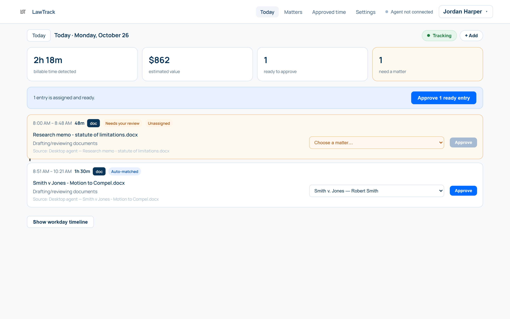
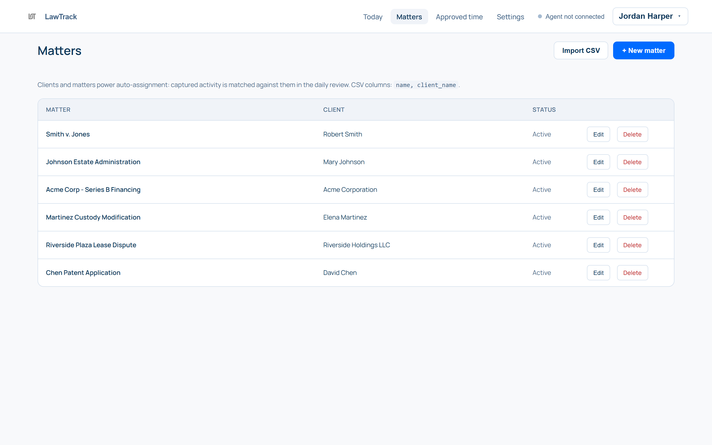
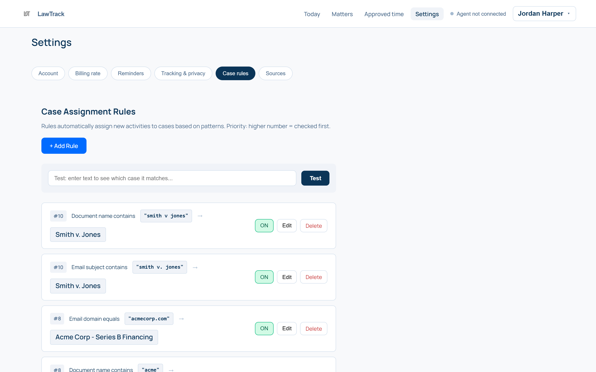
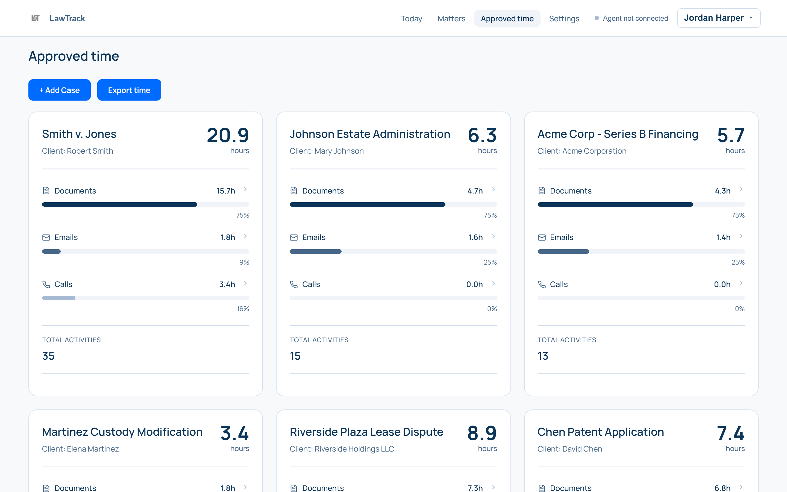
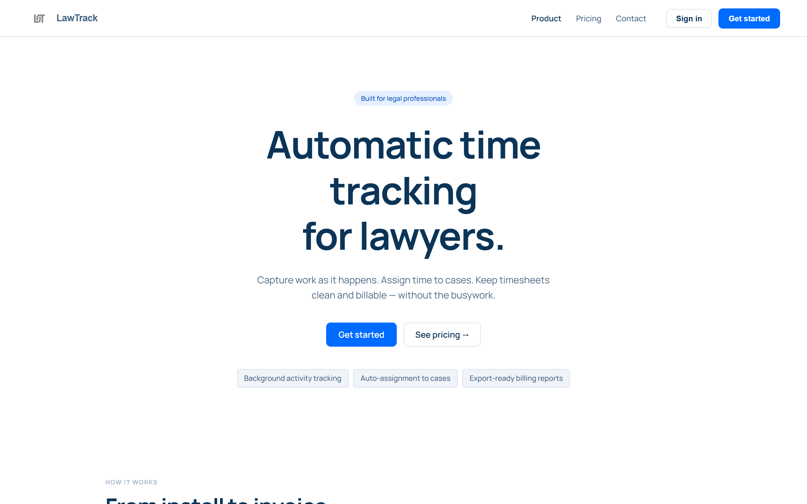
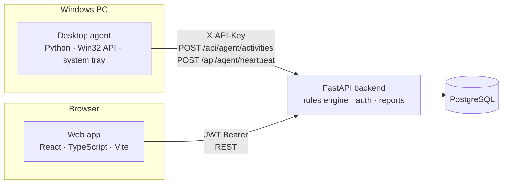

# LawTrack

**Automatic time tracking for lawyers.** A Windows desktop agent captures billable work as it happens: documents drafted, emails answered, calls taken. A rules engine files each block of time under the right client matter, and a web app turns it into reviewed, invoice-ready timesheets.

[](https://github.com/bpickard38/lawtrack/actions/workflows/ci.yml)

**[Live demo →](https://lawtrack.vercel.app)** Click **Sign in**, then **Explore the demo account**. No signup needed.



---

## Why I built it

Lawyers bill in 6-minute increments, and many reconstruct their day from memory at 6 PM, so billable work gets forgotten. LawTrack replaces the reconstruction: it records what you actually worked on, suggests which matter it belongs to, and leaves you a one-click review at the end of the day.

## Features

- **Passive desktop tracking.** A Windows system-tray agent polls the foreground window via the Win32 API, classifies it (Word document, Outlook email, Zoom/Teams call, browser), and posts finished time blocks to the API. Live heartbeats show "currently working on…" in the web app.
- **Rule-based auto-assignment.** Each attorney defines prioritized rules (`document name contains "smith v jones"`, `email domain equals acmecorp.com`, …). Incoming activity is matched server-side and tagged *Auto-matched*. Anything unmatched lands in a review queue.
- **Daily review workflow.** Activities move from `captured` → `edited` → `approved` → `invoiced`. You can bulk-approve, merge, split, or drag entries on a weekly calendar.
- **Billing reports and PDF invoices.** Per-matter hour breakdowns by activity type, CSV export, and client invoices generated in the browser with jsPDF.
- **Privacy controls.** Excluded keywords are checked before an activity is stored, so personal apps and sites are never recorded at all.
- **Multi-tenant and role-aware.** Data is scoped per attorney and per firm, with `attorney`, `billing`, and `admin` roles, JWT auth for the web app, Google sign-in, and separate hashed API keys for the desktop agent.

| Matters | Auto-assignment rules |
|---|---|
|  |  |
| **Approved time by matter** | **Landing page** |
|  |  |

## Architecture



| Component | Stack | Hosted on |
|---|---|---|
| `frontend/` | React 18, TypeScript, Vite, jsPDF | Vercel |
| `backend/` | FastAPI, SQLAlchemy, PostgreSQL, python-jose (JWT), passlib/bcrypt, slowapi rate limiting | Railway |
| `Agent/` | Python, pywin32, pystray, PyInstaller and Inno Setup installer | GitHub Releases |

### Design decisions worth calling out

- **Two auth paths.** The browser uses expiring JWTs. The desktop agent gets a long-lived per-attorney API key, which is stored only as a SHA-256 hash and looked up by prefix, so a leaked database row can't be replayed. Users never copy the key: the agent signs in once with email and password and exchanges them for it.
- **Matching happens on the server, not the agent.** Rules can change without redeploying desktop clients, and the same matcher ([`backend/rules.py`](backend/rules.py)) powers live capture, the rule "test" box, and the demo seeder.
- **Excluded means never stored.** Exclusions are enforced when activity is captured, not hidden later, because privacy filtering applied after the fact isn't privacy.
- **A self-healing public demo.** The demo account ([`backend/demo.py`](backend/demo.py)) is rebuilt on login once it's an hour old, with timestamps relative to "now", so the data is always current and visitor edits are wiped. Password, email, and account deletion are blocked for it.

## Running locally

**Prerequisites:** Python 3.11+, Node 18+, and PostgreSQL (or Docker).

On Windows, one script starts everything (Postgres in Docker, backend, frontend, and a fresh agent build):

```powershell
.\run-local.ps1
```

Or run each piece manually:

```bash
# 1. Backend
cd backend
python -m venv venv && source venv/bin/activate   # Windows: .\venv\Scripts\Activate.ps1
pip install -r requirements.txt
cp .env.example .env            # set DATABASE_URL and SECRET_KEY
python init_db.py               # creates tables + seeds the demo account
uvicorn main:app --reload       # http://localhost:8000

# 2. Frontend (new terminal)
cd frontend
npm install
npm run dev                     # http://localhost:5173
```

Sign in with **demo@lawtrack.app / demo1234**, or use the "Explore the demo account" button.

The desktop agent is Windows-only. See [`Agent/README.md`](Agent/README.md) for running it from source or building the installer.

## Tests

```bash
cd backend
pip install -r requirements-dev.txt
pytest
```

The suite runs the real FastAPI app against a throwaway SQLite database. It covers authentication, rule matching and priority, agent ingestion and exclusions, cross-tenant access control (one attorney can't read or modify another's data), and the demo account's protections. CI runs the tests plus a TypeScript type-check and production build on every push.

## Project structure

```
backend/
  main.py          API routes (auth, matters, activities, rules, agent, reports)
  rules.py         auto-assignment matcher
  demo.py          public demo account seeding and refresh
  models.py        SQLAlchemy models
  tests/           pytest suite
frontend/src/
  components/      Today (daily review), Timesheet (calendar), CaseReports, CaseRules, Settings, ...
  utils/           invoice PDF generation, date helpers
Agent/
  tracker.py       foreground-window polling and heartbeats
  classifier.py    app/window → document | email | call
  sender.py        API client
  app.py           system-tray entry point
scripts/
  take_screenshots.py   regenerates the images in this README
```

## Roadmap

- Outlook/Gmail API integration for exact email metadata instead of window-title parsing
- macOS agent
- Learned matter suggestions from past manual assignments, on top of explicit rules
- LEDES export for e-billing systems
